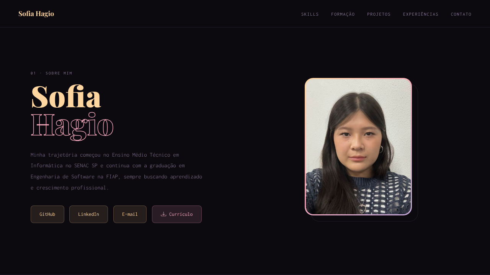

<div align="center">

# Sofia Hagio · Portfólio

**Meu portfólio pessoal: trajetória, habilidades, projetos e experiência em um só lugar**

Feito do zero com HTML, CSS e JavaScript, sem frameworks.

[](https://sofiahagio.vercel.app/)
[](https://linkedin.com/in/sofiahagio)




</div>

---

## Seções

| Seção | Conteúdo |
|---|---|
| **Sobre mim** | Apresentação, links e download do currículo |
| **Skills** | Habilidades técnicas separadas por categoria |
| **Formação** | Engenharia de Software na FIAP e Técnico em Informática no SENAC |
| **Projetos** | Trabalhos com links para o repositório, o site e a simulação |
| **Experiência** | Experiência profissional |
| **Contato** | Canais de contato |

---

## Destaques

- **Responsivo:** o layout se adapta ao computador, ao tablet e ao celular.
- **Animações leves:** as seções aparecem suavemente conforme a página rola, sem bibliotecas externas.
- **Menu inteligente:** o item da seção que está na tela fica destacado.
- **Componentes reaproveitáveis:** cartões, etiquetas e cores de destaque definidos uma vez no CSS e usados em todas as seções.

---

## Como executar

O site é estático: não precisa de instalação nem de build.

```bash
git clone https://github.com/SofiaHagio/Portifolio.git
cd Portifolio
```

Depois, abra o `index.html` no navegador ou use a extensão **Live Server** do VS Code.

---

## Estrutura

```
Portifolio/
├── index.html                  # Página principal
├── assets/
│   ├── css/style.css           # Toda a estilização
│   ├── js/script.js            # Animações e menu ativo
│   ├── images/                 # Foto e preview deste README
│   └── docs/                   # Currículo em PDF
└── README.md
```

---

## Tecnologias

- **HTML5, CSS3 e JavaScript**
- **Google Fonts:** Playfair Display e Inconsolata
- **Bootstrap Icons e Devicon:** ícones
- **Vercel:** publicação do site
